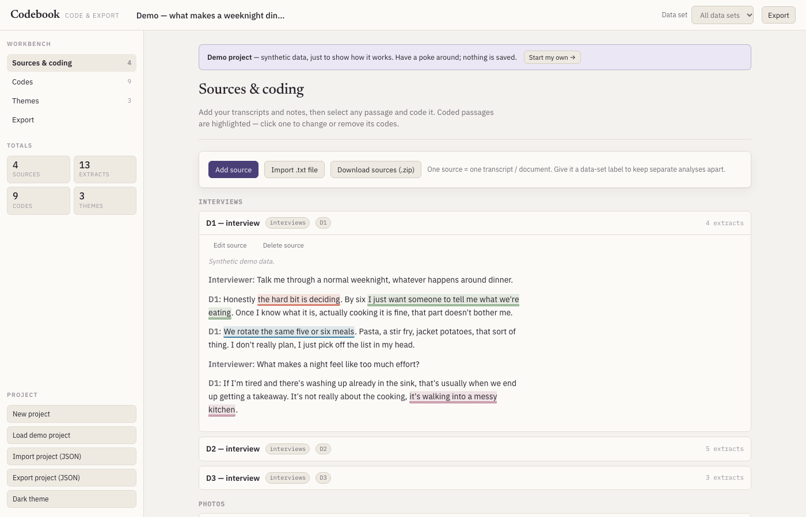
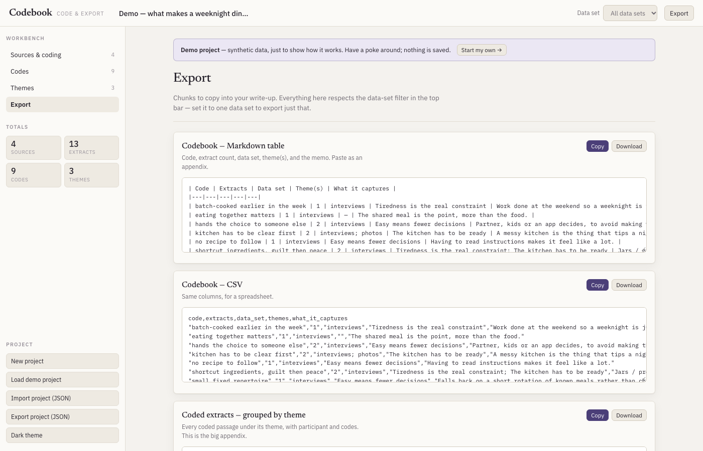

# Codebook

**A browser tool for coding qualitative transcripts and exporting the results** — a codebook, and every coded extract grouped by theme or by code, ready to paste into a write-up.

**[Live demo →](https://jwseymour.github.io/inductive-thematic-analysis-codebook/)** (opens on a synthetic example project)

## Why I built it

Qualitative researchers doing inductive thematic analysis usually juggle transcripts, a codebook spreadsheet and a pile of copy-pasted quotes. Heavyweight tools (NVivo, ATLAS.ti) are paid and overkill for a small study; spreadsheets get unwieldy. This tool does only the mechanical part — tagging passages, keeping codes and themes tidy, collating extracts — and leaves the interpreting and writing to the researcher.

Design goals: zero setup, zero dependencies, and **no data leaving the machine** (important when transcripts are sensitive).

## Highlights

- **Zero dependencies, no build step** — plain HTML, CSS and ~1,000 lines of vanilla JavaScript. Works offline.
- **Private by design** — all state lives in `localStorage`; no backend, no analytics, no network calls beyond web fonts.
- **Full coding workflow** — select text to code it, merge/rename/recolour codes, group codes into themes, filter by data set.
- **Publication-ready exports** — Markdown or CSV codebook, extracts grouped by theme or code, one combined bundle.
- **Portable** — whole project round-trips as JSON (including character offsets), and sources export as a `.zip`.
- **Polished UI** — light/dark theme, typographic design with a calm reading view.

## Technical notes

- Single-page app with a small hand-rolled DOM helper and view-per-tab rendering; no framework.
- Selections are stored as paragraph index + character offsets, so projects export and re-import losslessly.
- Project schema is versioned (`version: 2`) with a `migrate()` step so older saved projects keep loading.
- Generates `.zip` archives client-side without a library.

---

It's one HTML file plus a stylesheet and a script. No build step, no server, no
account, nothing to install. Open `index.html` in a browser and it works, online or
off. Everything you do is kept in that browser's local storage — nothing is sent
anywhere, there is no backend and no analytics.

It does the mechanical part of thematic-style analysis — tagging passages, keeping the
codes and themes tidy, and collating extracts — and nothing else. The reading,
interpreting and writing happen in your own document. It opens on a small synthetic
demo project; start your own from the Project menu.

## What it does

| Section | |
|---|---|
| **Sources & coding** | Add transcripts and documents as *sources* (paste text or import a `.txt`). Give each a **data-set label** if you're analysing more than one body of material. Select any passage → **＋ Code selection** → attach an existing code or make a new one. Coded passages are highlighted; click one to change or remove its codes. |
| **Codes** | Every code with its extract count. Rename, recolour, merge duplicates, and write the one-line memo that becomes the codebook's "what it captures" column. |
| **Themes** | Group codes into themes so the exports can collate extracts by theme. Optional one-line definition per theme. Codes not yet in a theme sit in a pool at the bottom. |
| **Export** | The point of the tool. Copy-paste chunks: the codebook (Markdown table or CSV), coded extracts grouped by theme, coded extracts grouped by code, the theme list, or one combined Markdown bundle. Everything respects the **Data set** filter in the top bar. |
| **Project menu** | New project · Load demo · Import / Export project (JSON) · light/dark. |

## Getting your data out

- **Export tab** — the copy-paste chunks above. Copy always works; Download may be
  blocked when the page is hosted.
- **Project → Export project (JSON)** — the whole project (sources, codes, every coded
  extract with offsets, themes) as one file. Re-import any time, or read it with your
  own script. This is also your backup / how you move between machines.

## Running it

- **Locally:** download `index.html`, `app.css`, `app.js`, `demo-project.json` and open
  `index.html`.
- **GitHub Pages:** Settings → Pages → deploy from `main`. Served
  at `https://<you>.github.io/<repo>/`.

## Notes

- Coding is **paragraph-scoped** — select within a single paragraph or speaker turn.
  Fine for transcripts; a selection spanning paragraphs is refused.
- Storage is per-browser `localStorage`. Export the project JSON to keep anything you
  care about.
- **Single-coder** by design — no inter-rater or multi-coder features.
- Not affiliated with anyone. If you use it for research, cite whatever method you're
  actually following (e.g. Braun & Clarke, 2006, for thematic analysis).

## Licence

MIT — see [LICENSE](LICENSE).
